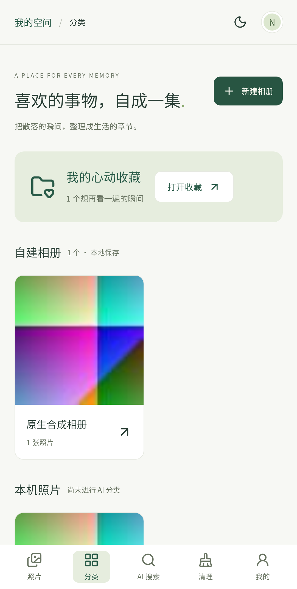
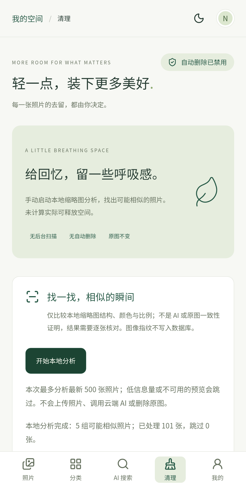

# NOBI Photos · Phase 3 交付与验收报告

日期：2026-10-21（Asia/Shanghai）。版本：0.3.0。基线：Phase 2 提交 `8ab1714`，开始时工作区干净。

按已确认顺序完成 Android 原生运行补验，再实现自建相册、手动标签与本地相似照片建议。代码与开发 APK 已交付，Phase 3 到此停止，等待验收。

## 功能验收

| 功能         | 结果                                                                                        |
| ------------ | ------------------------------------------------------------------------------------------- |
| 自建相册     | 新建、改名、搜索选片、调整成员、移除确认；支持空相册和多相册归属                            |
| 手动标签     | 照片详情编辑、去重与长度校验、离线关键词搜索；不写入系统照片                                |
| 本地数据     | 浏览器旧记录兼容；原生复用已有 SQLite v2 表，参数化事务写入；重扫保留存续照片整理数据       |
| 相似建议     | 主动开始、进度、取消、最多 500 张；本地缩略图 dHash、色彩、宽高比比较，低信息图片跳过       |
| 建议复核     | 逐组保留，本次内存会话有效；没有删除原图、释放空间或重复文件判定功能                        |
| 隐私中心     | 说明相册/标签清除范围与指纹内存使用；后台取消分析并清空结果                                 |
| 原生运行修正 | 关闭 Capacitor 桥接日志；使用原生 SystemBars inset 处理，避免旧 WebView 过早注入 CSS 的错误 |

最多 200 个自建相册，每个名称 1–40 字符、最多 10,000 个成员；编辑器显示前 200 个匹配结果，可搜索。每张照片最多 20 个手动标签，每个最多 24 字符。相似建议可能误判、漏判，不是语义 AI 或字节级去重。浏览器演示数据与原生照片始终分离。

## 检查与运行证据

| 检查                     | 结果                                                                            |
| ------------------------ | ------------------------------------------------------------------------------- |
| ESLint                   | 通过，0 错误、0 警告                                                            |
| TypeScript               | 通过                                                                            |
| Vitest                   | 9 文件、50 项通过                                                               |
| 桌面/手机端到端          | 10 项通过，包含相册编辑、标签、收藏持久化、离线搜索、本地 Canvas 分析与原有流程 |
| Vite 生产构建            | 通过，PWA 预缓存 47 项，约 277 KiB                                              |
| Capacitor 同步与配置检查 | 通过；Android/iOS 同步本地资源，桥接日志关闭、只读照片与备份策略通过            |
| Android Debug 构建       | Java 21 / SDK 36，`:app:assembleDebug` 成功，versionCode 3 / versionName 0.3.0  |
| Android 插件 lint        | `:nobi-photo-library:lintDebug` 成功，无问题                                    |
| 原生 Android 14 集成     | 专用 AOSP API 34 模拟器真实执行，通过；全部图片为脚本合成                       |

Vitest 覆盖旧数据兼容、浏览器存储失败、相册/标签校验、原生 SQL 与事务、重扫保留整理数据及失效成员清理、相似度阈值/非传递分组、取消与 500 张上限，并保留 Phase 2 扫描权限测试。端到端测试验证无外部主机请求；这不等同于全平台网络审计。

`npm run format:check` 与 `git diff --check` 通过；本次在线 `npm audit --audit-level=low` 返回 0 个已报告漏洞。APK SHA-256：`acd9f3cb7df6da1e0d85214e0b4bef4a204b414dcbeddf625f6206156447eb66`。

原生验证通过 `scripts/native-smoke.mjs` 执行：首次权限为 prompt、实际系统拒绝、重新请求并实际允许全部、101 张 MediaStore 图片分页索引、原生 SQLite 查询、JPEG 缩略图、收藏刷新恢复、自建相册刷新恢复、手动标签 SQL 查询以及 101 张本地分析生成建议。并非 mock。脚本仅允许名为 `nobi_photos_test` 的模拟器，结果见 [JSON](validation/android-api34-result.json)。页面重新加载已验证；不将其称为进程冷启动验证。

## 交付物与限制

- Debug APK：`artifacts/NOBI-Photos-0.3.0-debug.apk`，附 `.sha256`；构建物与 AVD 不纳入 Git。
- 可复跑的原生验证脚本：`npm run test:native`，配置与数据清理范围见 README。
- [原生测试矩阵](NATIVE-TEST-MATRIX.md) 标出已执行子集与待执行场景。
- iOS 未编译或运行：当前 Windows 无 Xcode。Android 有限授权/范围缩减、API 24–33、物理设备、大型真实图库、能耗与完整后台/冷启动矩阵仍待验证。
- Android 应用级 lint 的 Phase 2 基线为 0 错误、14 个模板资源/工具版本提示；本阶段重跑照片插件 lint，不声称所有平台提示归零。
- APK 为开发签名，不是商店发布包；没有发布、推送或触发远程 CI。

## 隐私与项目范围

不上传照片、不调用云端 AI、不自动删除原图，不要求注册。相似分析只读取本地缩略图，指纹不写入数据库；取消不发布半次分析结果。Android 无 INTERNET 权限，iOS PhotoKit 禁止网络获取缩略图；数据库仍是本地 `nobi_photos`，无生产数据库连接。元数据没有应用层加密。

代码改动只在本项目。SDK/AVD 是开发测试工具，未操作其他 NOBI 项目。原生测试仅使用自生成图片，未读取私人照片。相册移除、索引清理与失效记录删除都只作用于本应用元数据。
